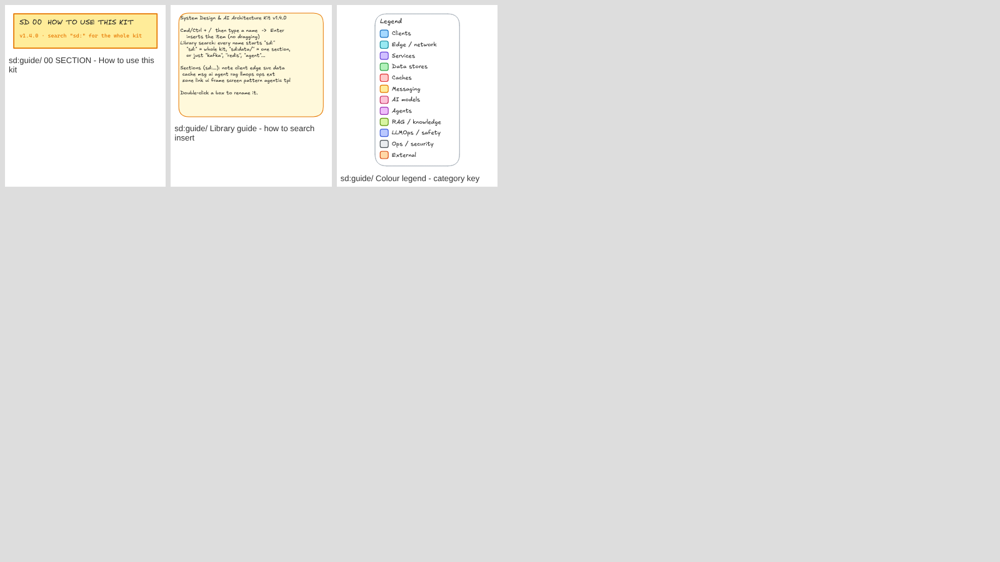

# Catalog

Every item, by section. Search the library for the prefix (for example `sd:data/`) to see one section, or `sd:` for the whole kit. Text after ` - ` in a name is search tags.

| # | Prefix | Section | Items |
|---|---|---|---|
| 00 | [`sd:guide/`](#00-guide) | How to use this kit | 2 |
| 01 | [`sd:note/`](#01-note) | Interview notes | 24 |
| 02 | [`sd:client/`](#02-client) | Clients, devices & AI clients | 28 |
| 03 | [`sd:edge/`](#03-edge) | Edge & networking | 8 |
| 04 | [`sd:svc/`](#04-svc) | Services & compute | 24 |
| 05 | [`sd:data/`](#05-data) | Databases & storage | 19 |
| 06 | [`sd:cache/`](#06-cache) | Caches | 6 |
| 07 | [`sd:msg/`](#07-msg) | Messaging & streaming | 9 |
| 08 | [`sd:ai/`](#08-ai) | AI models & inference | 15 |
| 09 | [`sd:agent/`](#09-agent) | Agents & orchestration | 18 |
| 10 | [`sd:rag/`](#10-rag) | Knowledge & retrieval (RAG) | 11 |
| 11 | [`sd:llmops/`](#11-llmops) | Safety, evals & LLMOps | 11 |
| 12 | [`sd:ops/`](#12-ops) | Observability, security & ops | 8 |
| 13 | [`sd:ext/`](#13-ext) | External systems | 5 |
| 14 | [`sd:zone/`](#14-zone) | Boundaries & zones | 9 |
| 15 | [`sd:link/`](#15-link) | Arrows & connectors | 11 |
| 16 | [`sd:ui/`](#16-ui) | UI components | 31 |
| 17 | [`sd:frame/`](#17-frame) | Device frames | 6 |
| 18 | [`sd:screen/`](#18-screen) | Screen wireframes | 13 |
| 19 | [`sd:pattern/`](#19-pattern) | Architecture patterns | 12 |
| 20 | [`sd:agentic/`](#20-agentic) | Agentic patterns | 12 |
| 21 | [`sd:tpl/`](#21-tpl) | Full interview designs | 21 |

## 00 `sd:guide/` How to use this kit

- **Library guide** - how to search insert
- **Colour legend** - category key

## 01 `sd:note/` Interview notes

- **Interview Flow** - steps checklist 45 min
- **Requirements** - functional non-functional
- **Capacity Estimates** - back of envelope qps storage
- **API Design** - rest endpoints contract
- **Data Model** - table entity schema
- **Data Model** - one to many relation erd
- **Trade-offs** - pros cons decision
- **Bottleneck** - spof risk callout
- **Deep Dive** - focus area
- **Latency Numbers** - cheat sheet every engineer
- **Capacity Cheat Sheet** - powers of two availability nines
- **Title** - diagram heading
- **Sticky Note** - yellow
- **Sticky Note** - blue question
- **Sticky Note** - pink assumption
- **Step 1** - numbered flow marker
- **Step 2** - numbered flow marker
- **Step 3** - numbered flow marker
- **Step 4** - numbered flow marker
- **Step 5** - numbered flow marker
- **Step 6** - numbered flow marker
- **Step 7** - numbered flow marker
- **Step 8** - numbered flow marker
- **Step 9** - numbered flow marker

## 02 `sd:client/` Clients, devices & AI clients

- **Clients Group** - all devices mobile tablet laptop web client clients starter
- **AI Clients Group** - chat app agent mcp voice ai client clients starter
- **First Request** - classic dns cdn lb gateway client clients starter
- **First Request** - AI llm gateway streaming ai client clients starter
- **User** - person actor end user client clients device
- **Users** - many traffic actors client clients device
- **Mobile App** - ios android phone smartphone client clients device
- **Web Browser** - web app spa frontend client clients device
- **Laptop** - computer notebook macbook pc web client clients device
- **Tablet** - ipad android tablet client clients device
- **Desktop App** - electron native pc mac windows client clients device
- **Smart TV** - tv set-top box streaming roku client clients device
- **Smartwatch** - wearable apple watch wear os client clients device
- **Voice Speaker** - alexa google home smart speaker voice client clients device
- **Car / In-vehicle** - carplay android auto vehicle telematics client clients device
- **Kiosk / POS** - point of sale terminal self-service client clients device
- **IoT Device** - sensor edge device embedded client clients device
- **Partner API / SDK** - b2b third party integration api consumer client clients device
- **Bot / Crawler** - scraper crawler search bot client clients device
- **Admin / Ops** - internal user back office client clients device
- **AI Chat App** - chatgpt claude gemini assistant app ai client clients llm
- **AI Agent** - autonomous agent api caller agentic ai client clients llm
- **MCP Client** - model context protocol claude desktop host ai client clients llm
- **IDE Copilot** - cursor copilot claude code ide assistant ai client clients llm
- **Voice AI** - realtime voice assistant speech ai client clients llm
- **Browser Agent** - computer use web agent operator ai client clients llm
- **Automation / Webhook** - n8n zapier make workflow webhook ai client clients llm
- **CLI / Developer** - cli terminal developer sdk script ai client clients llm

## 03 `sd:edge/` Edge & networking

- **DNS** - route53 domain name resolution geo routing
- **CDN** - cloudfront akamai edge cache static assets
- **Load Balancer** - lb elb alb nlb l4 l7 round robin
- **API Gateway** - auth routing throttling bff kong
- **Reverse Proxy (Nginx)** - nginx envoy haproxy tls termination
- **WAF / Firewall** - security ddos waf firewall
- **Rate Limiter** - throttle token bucket leaky bucket sliding window
- **Edge Function** - cloudflare workers lambda edge compute middleware

## 04 `sd:svc/` Services & compute

- **Service** - microservice api backend app server
- **Web Server** - http app server host vm ec2
- **Worker** - consumer background job processor async
- **Scheduler / Cron** - cron job batch scheduled timer
- **Serverless Function** - lambda cloud function faas
- **Container / Pod** - docker kubernetes k8s pod ecs
- **Auth Service** - authentication oauth jwt sso login identity
- **Notification Service** - push apns fcm alerts
- **Email / SMS** - ses sendgrid twilio sms email
- **Chat Service** - messaging realtime
- **WebSocket Server** - realtime bidirectional socket connection gateway
- **Search Service** - query full text lookup
- **Payment Service** - stripe psp billing checkout
- **Location Service** - geo geohash quadtree maps gps
- **Media Service** - upload transcode image video
- **ID Generator** - snowflake unique id ticket server uuid
- **Ranking / Recommendation** - feed ranking recommender top k leaderboard
- **Config / Coord (ZooKeeper)** - zookeeper etcd consul leader election config
- **Feature Flags** - launchdarkly toggles experiments ab test
- **Circuit Breaker** - resilience fallback hystrix retry
- **Service Mesh** - istio linkerd envoy sidecar mtls
- **Distributed Lock** - redlock etcd lease fencing token mutex
- **Autoscaler** - hpa kubernetes karpenter scale out elastic
- **Idempotency Store** - idempotency key dedupe exactly once retries

## 05 `sd:data/` Databases & storage

- **SQL Database** - relational rdbms acid
- **PostgreSQL** - postgres sql relational
- **MySQL** - sql relational aurora
- **Primary DB** - leader master writer
- **Read Replica** - follower slave reader replication
- **Shard** - partition horizontal scaling
- **Document DB (MongoDB)** - nosql mongodb json document
- **Wide-column (Cassandra)** - cassandra scylla hbase nosql
- **Key-Value (DynamoDB)** - dynamodb kv nosql
- **Graph DB (Neo4j)** - neo4j social graph relationships
- **Time-series DB** - influxdb timescale prometheus metrics
- **Search Index (Elasticsearch)** - elasticsearch opensearch inverted index full text
- **Object Storage (S3)** - s3 blob gcs files images video
- **Data Warehouse** - snowflake bigquery redshift olap analytics
- **Data Lake** - s3 parquet raw data hdfs
- **Lakehouse (Iceberg)** - iceberg delta lake table format parquet
- **OLAP DB (ClickHouse)** - clickhouse druid pinot realtime analytics columnar
- **Vector DB** - pgvector pinecone weaviate qdrant embeddings ann
- **File / Doc Store** - files documents metadata

## 06 `sd:cache/` Caches

- **Cache** - in-memory read through cache aside
- **Redis** - cache in-memory kv sorted set pubsub
- **Memcached** - cache in-memory kv
- **Local Cache** - in-process lru app cache
- **Session Store** - sessions tokens redis
- **Bloom Filter** - probabilistic membership false positive

## 07 `sd:msg/` Messaging & streaming

- **Message Queue** - mq async buffer decouple
- **Kafka** - event log stream topic partitions
- **RabbitMQ** - amqp broker queue
- **SQS** - aws queue
- **Pub/Sub Topic** - sns fan out broadcast topic
- **Dead Letter Queue** - dlq retry failed messages
- **Stream Processor (Flink)** - flink spark streaming kafka streams realtime
- **Batch / ETL (Spark)** - spark airflow etl batch pipeline mapreduce
- **CDC** - change data capture debezium outbox

## 08 `sd:ai/` AI models & inference

- **LLM** - large language model gpt claude gemini api inference ai
- **Small / Local Model** - slm on-device llama ollama edge model ai
- **Multimodal Model** - vision image understanding vlm ai
- **Speech-to-Text** - stt asr whisper transcription voice ai
- **Text-to-Speech** - tts voice synthesis elevenlabs ai
- **Image / Video Gen** - diffusion image generation video generation ai
- **Embedding Model** - embeddings encoder vectors ai
- **Reranker** - rerank cross encoder relevance ai
- **Model Serving (GPU)** - inference vllm triton gpu endpoint ai
- **AI Gateway / Model Router** - litellm openrouter routing fallback multi provider
- **Prompt Cache** - prompt caching prefix cache kv cache tokens
- **Batch Inference** - batch api offline async bulk jobs ai
- **Fine-tuned Model** - fine tuning lora sft custom model ai
- **Training Pipeline** - ml training mlops ai
- **Feature Store** - feast features ml ai

## 09 `sd:agent/` Agents & orchestration

- **AI Agent** - agent llm loop autonomous ai agentic
- **Supervisor Agent** - orchestrator manager multi-agent lead ai agentic
- **Sub-agent / Worker** - worker agent specialist delegate ai agentic
- **Planner** - plan task decomposition steps ai agentic
- **Tools** - function calling tool use api
- **Agent Skills** - skills instructions scripts progressive disclosure ai agentic
- **MCP Server** - model context protocol tools resources server ai agentic
- **A2A Protocol** - agent to agent communication interop ai agentic
- **Short-term Memory** - context window conversation buffer session ai agentic
- **Long-term Memory** - persistent memory vector kv user profile ai agentic
- **Agent State / Checkpoint** - state store checkpoint resume langgraph ai agentic
- **Human Approval** - human in the loop hitl review approve ai agentic
- **Code Sandbox** - code execution e2b container isolated ai agentic
- **Computer / Browser Use** - computer use browser automation ai agentic
- **Workflow Engine** - langgraph temporal durable workflow dag ai agentic
- **Agent Task Queue** - long running jobs async background ai agentic
- **Trigger / Scheduler** - cron event trigger webhook schedule ai agentic
- **Agent Registry** - catalog discovery agents directory agent card ai agentic

## 10 `sd:rag/` Knowledge & retrieval (RAG)

- **Data Sources** - pdf docs web pages database connectors ai retrieval augmented generation
- **Loader / Parser** - ingestion ocr parsing unstructured ai retrieval augmented generation
- **Chunker** - chunking split overlap ai retrieval augmented generation
- **Embedding Pipeline** - embed index batch ai retrieval augmented generation
- **Vector Index** - vector db ann hnsw pgvector pinecone ai retrieval augmented generation
- **Keyword Index (BM25)** - bm25 full text elasticsearch ai retrieval augmented generation
- **Hybrid Retriever** - hybrid search retrieval top k ai retrieval augmented generation
- **Knowledge Graph** - graphrag entities relations neo4j ai retrieval augmented generation
- **Context Builder** - prompt assembly context window packing ai retrieval augmented generation
- **Semantic Cache** - cache similar prompts ai retrieval augmented generation
- **Citations** - sources grounding attribution ai retrieval augmented generation

## 11 `sd:llmops/` Safety, evals & LLMOps

- **Guardrails** - safety moderation input output filter ai observability
- **PII Redaction** - privacy mask pii gdpr ai observability
- **Prompt Registry** - prompt versioning templates management ai observability
- **Offline Evals** - eval dataset benchmark regression ai observability
- **LLM-as-Judge** - online eval grading judge ai observability
- **Tracing** - langfuse langsmith opentelemetry spans ai observability
- **Token & Cost Metering** - usage billing tokens cost budget ai observability
- **User Feedback** - thumbs rating feedback loop rlhf ai observability
- **Red Teaming** - adversarial jailbreak prompt injection testing ai observability
- **Model Fallback** - failover retry provider outage ai observability
- **Permissions / Policy** - access control rbac tool permissions ai observability

## 12 `sd:ops/` Observability, security & ops

- **Monitoring** - metrics prometheus grafana dashboards
- **Logging** - logs elk loki splunk
- **Tracing** - distributed tracing opentelemetry jaeger
- **Alerting** - pagerduty on call alerts
- **Secrets / KMS** - vault kms secrets encryption keys
- **Identity Provider** - idp sso okta auth0 cognito
- **CI/CD** - pipeline deploy github actions
- **Analytics** - events clickstream product analytics

## 13 `sd:ext/` External systems

- **Third-party API** - external partner saas
- **Payment Gateway (Stripe)** - stripe adyen psp external
- **Push Provider (APNs / FCM)** - apns fcm push notifications external
- **Maps API** - google maps mapbox routing eta
- **Email / SMS Provider** - twilio sendgrid ses

## 14 `sd:zone/` Boundaries & zones

- **Region** - cloud region us-east eu-west
- **Availability Zone** - az datacenter
- **VPC** - virtual private cloud network
- **Public Subnet** - dmz internet facing
- **Private Subnet** - internal
- **Kubernetes Cluster** - k8s namespace
- **Trust Boundary** - security perimeter
- **Group Box** - logical component group
- **Client Server Split** - frontend backend divider

## 15 `sd:link/` Arrows & connectors

- **HTTP Request** - rest sync call
- **gRPC Call** - rpc internal
- **Response** - reply return
- **WebSocket** - bidirectional realtime
- **Async Event** - message publish
- **Replication** - copy sync data
- **Read Path** - query
- **Write Path** - mutate
- **Request and Response** - pair
- **Fan-out** - one to many arrows
- **Elbow Arrow** - orthogonal route

## 16 `sd:ui/` UI components

- **Button** - primary cta
- **Button** - secondary outline
- **Button** - danger destructive
- **Text Input** - field form label
- **Search Bar** - search field
- **Dropdown** - select menu
- **Checkbox** - tick option
- **Toggle Switch** - on off setting
- **Avatar** - profile picture user
- **Image Placeholder** - photo media
- **Card** - content tile
- **List Item** - row avatar title
- **Top App Bar** - header navbar
- **Bottom Tab Bar** - mobile navigation
- **Sidebar Navigation** - side menu
- **Tabs** - segmented control
- **Modal Dialog** - popup confirm
- **Toast** - snackbar alert message
- **Chips** - tags badges filters
- **Chat Bubbles** - messages conversation
- **Feed Post** - social card
- **Video Player** - media playback
- **Map View** - location pins route
- **Chart Widget** - bar graph kpi
- **KPI Stat Tile** - metric number
- **Data Table** - grid rows columns
- **Progress Bar** - loading upload
- **Skeleton Loader** - loading placeholder shimmer
- **Empty State** - no results zero data
- **Login Form** - sign in auth
- **UX Annotation** - numbered callout note

## 17 `sd:frame/` Device frames

- **Phone** - iphone android mobile device
- **Tablet** - ipad device
- **Laptop** - macbook notebook computer device
- **Browser Window** - web page desktop
- **Desktop App Window** - mac windows app
- **Smartwatch** - wearable

## 18 `sd:screen/` Screen wireframes

- **Login** - sign in onboarding mobile
- **Social Feed** - home timeline instagram twitter
- **Chat Conversation** - messaging whatsapp dm
- **Ride Booking** - uber map pickup driver
- **Product Detail** - ecommerce shop item
- **Checkout** - cart payment order summary
- **Profile** - user account social
- **Notifications** - activity inbox list
- **Seat Selection** - ticket booking cinema concert
- **Video Watch Page** - youtube streaming web
- **Admin Dashboard** - analytics web console
- **Search Results** - web search listing filters
- **AI Assistant Chat** - llm chatbot rag web

## 19 `sd:pattern/` Architecture patterns

- **3-Tier Web App** - client lb app db
- **Cache-Aside** - lazy loading read path
- **Write-Through Cache** - write path
- **Read Replicas** - leader follower replication
- **Sharding** - hash partition shard router
- **CQRS + Event Sourcing** - read write split
- **Saga Orchestration** - distributed transaction compensation
- **Transactional Outbox** - reliable events cdc
- **Pub/Sub Fan-out** - topic subscribers
- **API Gateway + BFF** - backend for frontend
- **Multi-Region Active-Active** - geo dns failover
- **Async Job Queue** - background workers

## 20 `sd:agentic/` Agentic patterns

- **Prompt Chaining** - sequential llm steps gate ai agent
- **Routing** - classify and send to specialist ai agent
- **Parallelization** - sectioning voting fan-out ai agent
- **Orchestrator-Workers** - dynamic subtasks ai agent
- **Evaluator-Optimizer** - generate critique refine loop ai agent
- **Autonomous Agent** - react loop think act observe ai agent
- **Multi-Agent Supervisor** - team of specialist agents ai agent
- **Agentic RAG** - agent chooses retrieval sources ai agent
- **Agent Memory** - short term long term writer ai agent
- **Human-in-the-Loop** - approval before risky tools ai agent
- **MCP Architecture** - host client servers ai agent
- **A2A** - agent to agent across companies ai agent

## 21 `sd:tpl/` Full interview designs

- **URL Shortener** - tinyurl bitly
- **Rate Limiter** - throttling api limits
- **Chat System** - whatsapp messenger realtime
- **News Feed** - twitter timeline social
- **Video Streaming** - youtube netflix vod
- **Ride Sharing** - uber lyft dispatch geo
- **Notification System** - push email sms
- **Web Crawler** - search engine spider
- **Payment System** - stripe checkout ledger
- **Search Autocomplete** - typeahead suggestions trie
- **File Storage Sync** - dropbox google drive
- **Ticket Booking** - ticketmaster seats concerts
- **Proximity Service** - yelp nearby places
- **LLM Chat App** - chatgpt assistant genai
- **RAG Pipeline** - retrieval augmented generation
- **AI Agent Platform** - agentic tools mcp
- **Coding Agent** - claude code cursor ai developer
- **Deep Research Agent** - multi agent web research report
- **Customer Support Agent** - ai helpdesk escalation
- **Realtime Voice Agent** - phone call speech ai
- **Enterprise AI Gateway** - llm platform governance
