# Catalog

Every item, by section. Search the library for the prefix (for example `sd:data/`) to see one section, or `sd:` for the whole kit. Text after ` - ` in a name is search tags.

| # | Prefix | Section | Items |
|---|---|---|---|
| 00 | [`sd:guide/`](#00-guide) | How to use this kit | 2 |
| 01 | [`sd:note/`](#01-note) | Interview notes | 33 |
| 02 | [`sd:client/`](#02-client) | Clients, devices & AI clients | 28 |
| 03 | [`sd:edge/`](#03-edge) | Edge & networking | 8 |
| 04 | [`sd:svc/`](#04-svc) | Services & compute | 29 |
| 05 | [`sd:data/`](#05-data) | Databases & storage | 20 |
| 06 | [`sd:cache/`](#06-cache) | Caches | 6 |
| 07 | [`sd:msg/`](#07-msg) | Messaging & streaming | 9 |
| 08 | [`sd:ai/`](#08-ai) | AI models & inference | 19 |
| 09 | [`sd:agent/`](#09-agent) | Agents & orchestration | 41 |
| 10 | [`sd:rag/`](#10-rag) | Knowledge & retrieval (RAG) | 12 |
| 11 | [`sd:llmops/`](#11-llmops) | Safety, evals & LLMOps | 12 |
| 12 | [`sd:ops/`](#12-ops) | Observability, security & ops | 10 |
| 13 | [`sd:ext/`](#13-ext) | External systems | 6 |
| 14 | [`sd:zone/`](#14-zone) | Boundaries & zones | 9 |
| 15 | [`sd:link/`](#15-link) | Arrows & connectors | 16 |
| 16 | [`sd:ui/`](#16-ui) | UI components | 31 |
| 17 | [`sd:frame/`](#17-frame) | Device frames | 6 |
| 18 | [`sd:screen/`](#18-screen) | Screen wireframes | 13 |
| 19 | [`sd:pattern/`](#19-pattern) | Architecture patterns | 12 |
| 20 | [`sd:agentic/`](#20-agentic) | Agentic patterns | 21 |
| 21 | [`sd:tpl/`](#21-tpl) | Full interview designs | 53 |
| 22 | [`sd:fe/`](#22-fe) | Frontend architecture | 49 |
| 23 | [`sd:fep/`](#23-fep) | Frontend patterns | 15 |
| 24 | [`sd:emoji/`](#24-emoji) | Emoji | 3963 |

## 00 `sd:guide/` How to use this kit

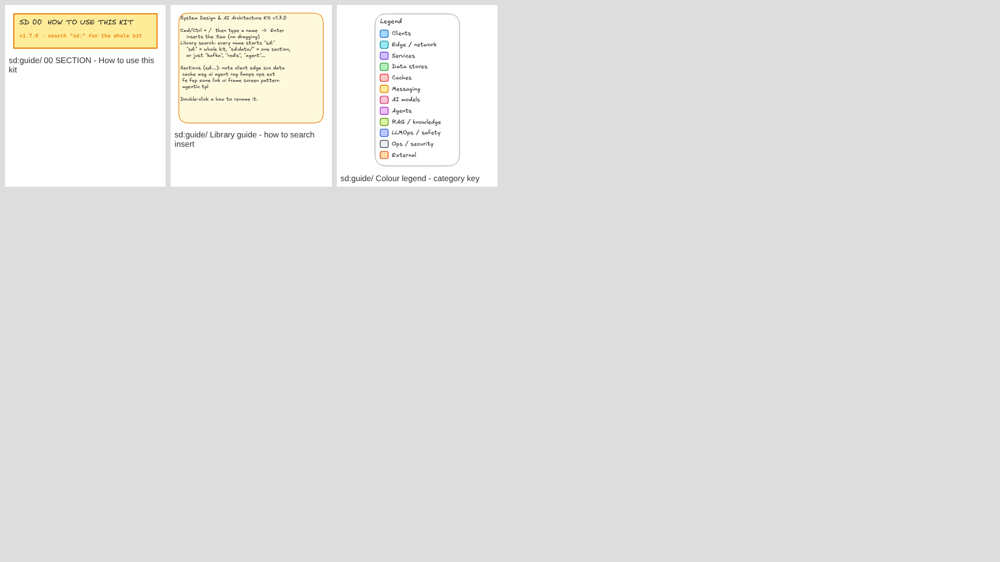

- **Library guide** - how to search insert
- **Colour legend** - category key

## 01 `sd:note/` Interview notes

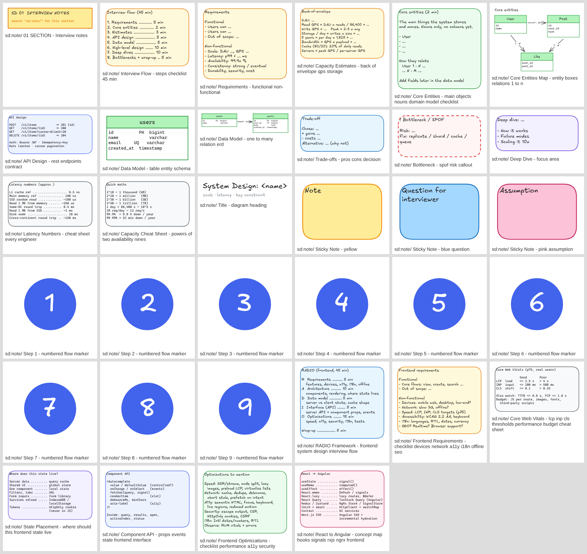

- **Interview Flow** - steps checklist 45 min
- **Requirements** - functional non-functional
- **Capacity Estimates** - back of envelope qps storage
- **Core Entities** - main objects nouns domain model checklist
- **Core Entities Map** - entity boxes relations 1 to n
- **API Design** - rest endpoints contract
- **Data Model** - table entity schema
- **Data Model** - one to many relation erd
- **Trade-offs** - pros cons decision
- **Bottleneck** - spof risk callout
- **Deep Dive** - focus area
- **Latency Numbers** - cheat sheet every engineer
- **Capacity Cheat Sheet** - powers of two availability nines
- **Title** - diagram heading
- **Sticky Note** - yellow
- **Sticky Note** - blue question
- **Sticky Note** - pink assumption
- **Step 1** - numbered flow marker
- **Step 2** - numbered flow marker
- **Step 3** - numbered flow marker
- **Step 4** - numbered flow marker
- **Step 5** - numbered flow marker
- **Step 6** - numbered flow marker
- **Step 7** - numbered flow marker
- **Step 8** - numbered flow marker
- **Step 9** - numbered flow marker
- **RADIO Framework** - frontend system design interview flow
- **Frontend Requirements** - checklist devices network a11y i18n offline seo
- **Core Web Vitals** - lcp inp cls thresholds performance budget cheat sheet
- **State Placement** - where should this frontend state live
- **Component API** - props events state frontend interface
- **Frontend Optimizations** - checklist performance a11y security
- **React to Angular** - concept map hooks signals rxjs ngrx frontend

## 02 `sd:client/` Clients, devices & AI clients

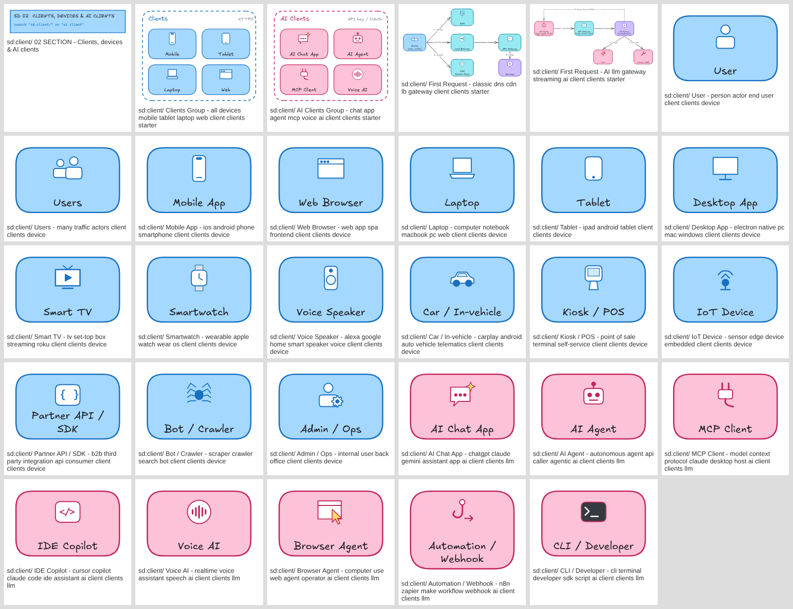

- **Clients Group** - all devices mobile tablet laptop web client clients starter
- **AI Clients Group** - chat app agent mcp voice ai client clients starter
- **First Request** - classic dns cdn lb gateway client clients starter
- **First Request** - AI llm gateway streaming ai client clients starter
- **User** - person actor end user client clients device
- **Users** - many traffic actors client clients device
- **Mobile App** - ios android phone smartphone client clients device
- **Web Browser** - web app spa frontend client clients device
- **Laptop** - computer notebook macbook pc web client clients device
- **Tablet** - ipad android tablet client clients device
- **Desktop App** - electron native pc mac windows client clients device
- **Smart TV** - tv set-top box streaming roku client clients device
- **Smartwatch** - wearable apple watch wear os client clients device
- **Voice Speaker** - alexa google home smart speaker voice client clients device
- **Car / In-vehicle** - carplay android auto vehicle telematics client clients device
- **Kiosk / POS** - point of sale terminal self-service client clients device
- **IoT Device** - sensor edge device embedded client clients device
- **Partner API / SDK** - b2b third party integration api consumer client clients device
- **Bot / Crawler** - scraper crawler search bot client clients device
- **Admin / Ops** - internal user back office client clients device
- **AI Chat App** - chatgpt claude gemini assistant app ai client clients llm
- **AI Agent** - autonomous agent api caller agentic ai client clients llm
- **MCP Client** - model context protocol claude desktop host ai client clients llm
- **IDE Copilot** - cursor copilot claude code ide assistant ai client clients llm
- **Voice AI** - realtime voice assistant speech ai client clients llm
- **Browser Agent** - computer use web agent operator ai client clients llm
- **Automation / Webhook** - n8n zapier make workflow webhook ai client clients llm
- **CLI / Developer** - cli terminal developer sdk script ai client clients llm

## 03 `sd:edge/` Edge & networking

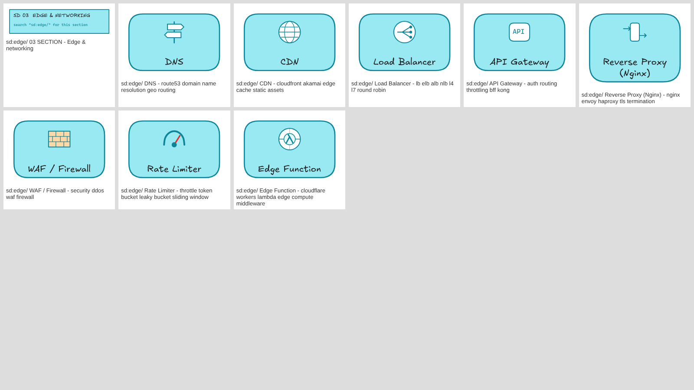

- **DNS** - route53 domain name resolution geo routing
- **CDN** - cloudfront akamai edge cache static assets
- **Load Balancer** - lb elb alb nlb l4 l7 round robin
- **API Gateway** - auth routing throttling bff kong
- **Reverse Proxy (Nginx)** - nginx envoy haproxy tls termination
- **WAF / Firewall** - security ddos waf firewall
- **Rate Limiter** - throttle token bucket leaky bucket sliding window
- **Edge Function** - cloudflare workers lambda edge compute middleware

## 04 `sd:svc/` Services & compute

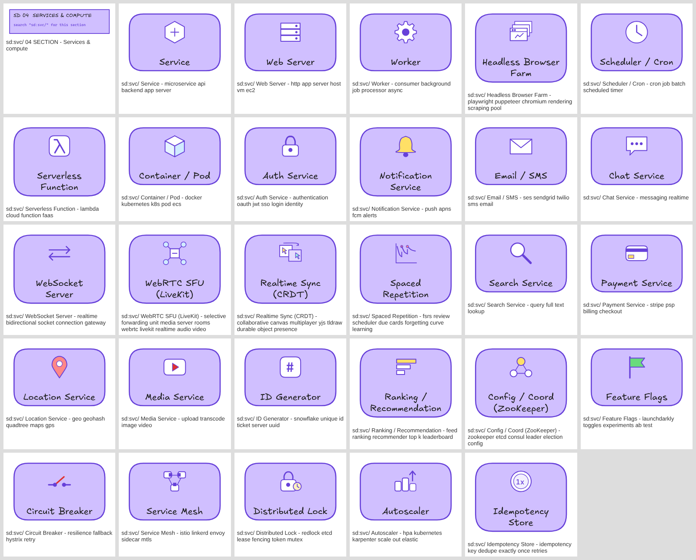

- **Service** - microservice api backend app server
- **Web Server** - http app server host vm ec2
- **SSR Web App** - server side rendering nextjs react server components vercel frontend
- **Worker** - consumer background job processor async
- **Headless Browser Farm** - playwright puppeteer chromium rendering scraping pool
- **Scheduler / Cron** - cron job batch scheduled timer
- **Serverless Function** - lambda cloud function faas
- **Container / Pod** - docker kubernetes k8s pod ecs
- **Auth Service** - authentication oauth jwt sso login identity
- **Notification Service** - push apns fcm alerts
- **Email / SMS** - ses sendgrid twilio sms email
- **Chat Service** - messaging realtime
- **WebSocket Server** - realtime bidirectional socket connection gateway
- **WebRTC SFU (LiveKit)** - selective forwarding unit media server rooms webrtc livekit realtime audio video
- **Realtime Sync (CRDT)** - collaborative canvas multiplayer yjs tldraw durable object presence
- **Spaced Repetition** - fsrs review scheduler due cards forgetting curve learning
- **Search Service** - query full text lookup
- **Payment Service** - stripe psp billing checkout
- **Location Service** - geo geohash quadtree maps gps
- **Media Service** - upload transcode image video
- **ID Generator** - snowflake unique id ticket server uuid
- **Ranking / Recommendation** - feed ranking recommender top k leaderboard
- **Config / Coord (ZooKeeper)** - zookeeper etcd consul leader election config
- **Feature Flags** - launchdarkly toggles experiments ab test
- **Circuit Breaker** - resilience fallback hystrix retry
- **Service Mesh** - istio linkerd envoy sidecar mtls
- **Distributed Lock** - redlock etcd lease fencing token mutex
- **Autoscaler** - hpa kubernetes karpenter scale out elastic
- **Idempotency Store** - idempotency key dedupe exactly once retries

## 05 `sd:data/` Databases & storage

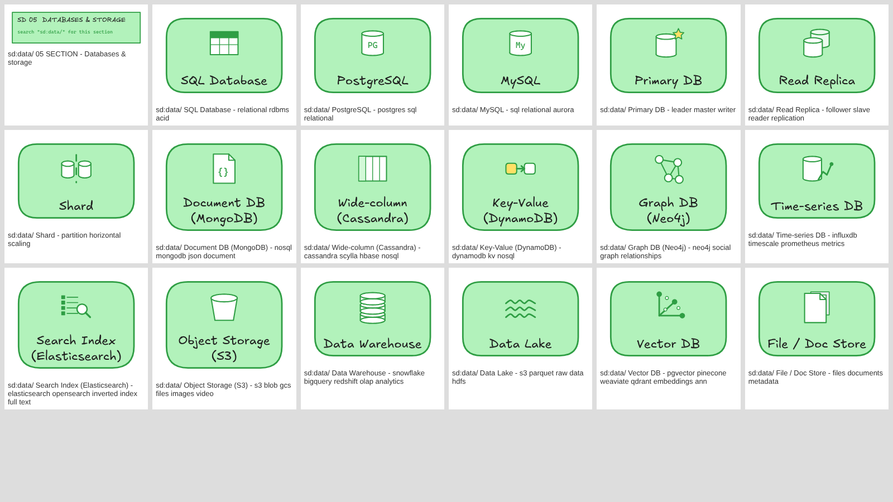

- **SQL Database** - relational rdbms acid
- **PostgreSQL** - postgres sql relational
- **MySQL** - sql relational aurora
- **Primary DB** - leader master writer
- **Read Replica** - follower slave reader replication
- **Shard** - partition horizontal scaling
- **Document DB (MongoDB)** - nosql mongodb json document
- **Wide-column (Cassandra)** - cassandra scylla hbase nosql
- **Key-Value (DynamoDB)** - dynamodb kv nosql
- **Graph DB (Neo4j)** - neo4j social graph relationships
- **Time-series DB** - influxdb timescale prometheus metrics
- **Search Index (Elasticsearch)** - elasticsearch opensearch inverted index full text
- **Object Storage (S3)** - s3 blob gcs files images video
- **Data Warehouse** - snowflake bigquery redshift olap analytics
- **Learner Model** - mastery skills evidence knowledge tracing learner profile
- **Data Lake** - s3 parquet raw data hdfs
- **Lakehouse (Iceberg)** - iceberg delta lake table format parquet
- **OLAP DB (ClickHouse)** - clickhouse druid pinot realtime analytics columnar
- **Vector DB** - pgvector pinecone weaviate qdrant embeddings ann
- **File / Doc Store** - files documents metadata

## 06 `sd:cache/` Caches

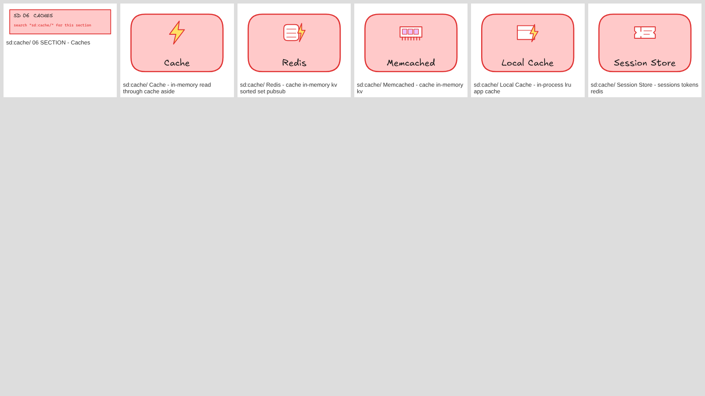

- **Cache** - in-memory read through cache aside
- **Redis** - cache in-memory kv sorted set pubsub
- **Memcached** - cache in-memory kv
- **Local Cache** - in-process lru app cache
- **Session Store** - sessions tokens redis
- **Bloom Filter** - probabilistic membership false positive

## 07 `sd:msg/` Messaging & streaming

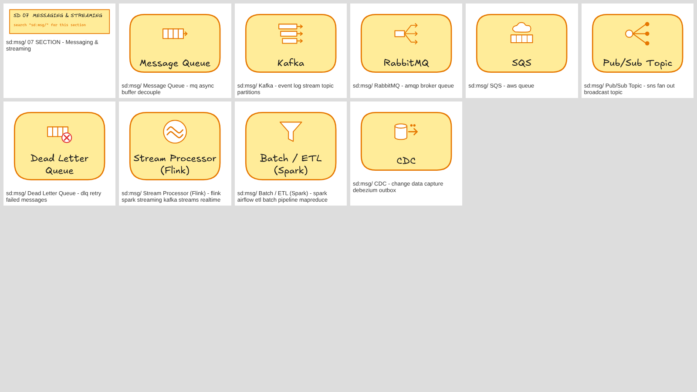

- **Message Queue** - mq async buffer decouple
- **Kafka** - event log stream topic partitions
- **RabbitMQ** - amqp broker queue
- **SQS** - aws queue
- **Pub/Sub Topic** - sns fan out broadcast topic
- **Dead Letter Queue** - dlq retry failed messages
- **Stream Processor (Flink)** - flink spark streaming kafka streams realtime
- **Batch / ETL (Spark)** - spark airflow etl batch pipeline mapreduce
- **CDC** - change data capture debezium outbox

## 08 `sd:ai/` AI models & inference

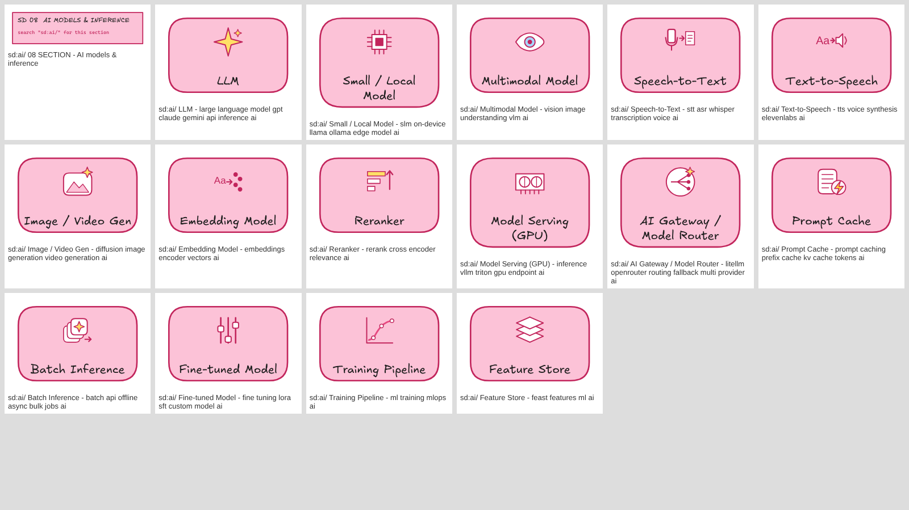

- **LLM** - large language model gpt claude gemini api inference ai
- **Small / Local Model** - slm on-device llama ollama edge model ai
- **Multimodal Model** - vision image understanding vlm ai
- **Speech-to-Text** - stt asr whisper transcription voice ai
- **Typed Classifier** - fast classifier routing intent label confidence structured output jev ai
- **Text-to-Speech** - tts voice synthesis elevenlabs ai
- **Turn Detector (VAD)** - voice activity detection end of turn barge-in interruption ai
- **Generative UI** - typed ui actions component catalog canvas artifacts ai
- **Visual Renderer (2D / 3D)** - threejs r3f 3d math graphs katex mermaid diagrams simulation canvas ai
- **Image / Video Gen** - diffusion image generation video generation ai
- **Embedding Model** - embeddings encoder vectors ai
- **Reranker** - rerank cross encoder relevance ai
- **Model Serving (GPU)** - inference vllm triton gpu endpoint ai
- **AI Gateway / Model Router** - litellm openrouter routing fallback multi provider ai
- **Prompt Cache** - prompt caching prefix cache kv cache tokens ai
- **Batch Inference** - batch api offline async bulk jobs ai
- **Fine-tuned Model** - fine tuning lora sft custom model ai
- **Training Pipeline** - ml training mlops ai
- **Feature Store** - feast features ml ai

## 09 `sd:agent/` Agents & orchestration

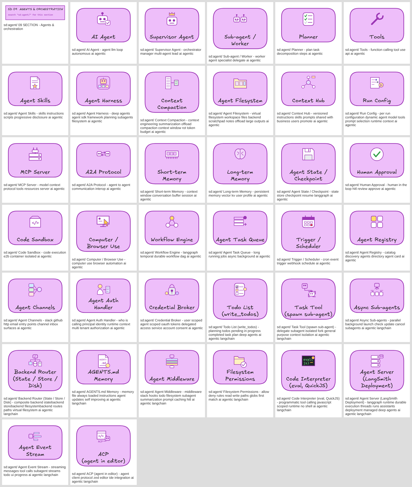

- **AI Agent** - agent llm loop autonomous ai agentic
- **Supervisor Agent** - orchestrator manager multi-agent lead ai agentic
- **Sub-agent / Worker** - worker agent specialist delegate ai agentic
- **Planner** - plan task decomposition steps ai agentic
- **Tools** - function calling tool use api ai agentic
- **Agent Skills** - skills instructions scripts progressive disclosure ai agentic
- **Agent Harness** - deep agents agent sdk framework planning subagents filesystem ai agentic
- **Context Compaction** - context engineering summarization offload compaction context window rot token budget ai agentic
- **Agent Filesystem** - virtual filesystem workspace files backend scratchpad notes offload large outputs ai agentic
- **Context Hub** - versioned instructions skills prompts shared with business users promote ai agentic
- **Run Config** - per run configuration dynamic agent model tools prompt selection runtime context ai agentic
- **MCP Server** - model context protocol tools resources server ai agentic
- **A2A Protocol** - agent to agent communication interop ai agentic
- **Short-term Memory** - context window conversation buffer session ai agentic
- **Long-term Memory** - persistent memory vector kv user profile ai agentic
- **Agent State / Checkpoint** - state store checkpoint resume langgraph ai agentic
- **Human Approval** - human in the loop hitl review approve ai agentic
- **Code Sandbox** - code execution e2b container isolated ai agentic
- **Computer / Browser Use** - computer use browser automation ai agentic
- **Workflow Engine** - langgraph temporal durable workflow dag ai agentic
- **Agent Task Queue** - long running jobs async background ai agentic
- **Trigger / Scheduler** - cron event trigger webhook schedule ai agentic
- **Agent Registry** - catalog discovery agents directory agent card ai agentic
- **Agent Channels** - slack github http email entry points channel inbox surfaces ai agentic
- **Agent Auth Handler** - who is calling principal identity runtime context multi tenant authorization ai agentic
- **Credential Broker** - user scoped agent scoped oauth tokens delegated access service account consent ai agentic
- **MicroVM Sandbox** - agent sandbox firecracker gvisor kata isolation untrusted code per run microvm ai agentic
- **Trace Store + Replay** - agent traces spans opentelemetry genai replay rewind time travel debug runs ai agentic
- **Spend Cap / Cost Meter** - budget token cost meter per tenant per run limit quota llm spend ai agentic
- **MCP Gateway** - mcp proxy gateway routing auth tool allowlist mcp-method mcp-name headers audit ai agentic
- **Todo List (write_todos)** - planning todos pending in progress completed task plan deep agents ai agentic langchain
- **Task Tool (spawn sub-agent)** - delegate subagent isolated fork general purpose context isolation ai agentic langchain
- **Async Sub-agents** - parallel background launch check update cancel subagents ai agentic langchain
- **Backend Router (State / Store / Disk)** - composite backend statebackend storebackend filesystembackend routes paths virtual filesystem ai agentic langchain
- **AGENTS.md Memory** - memory file always loaded instructions agent updates self improving ai agentic langchain
- **Agent Middleware** - middleware stack hooks todo filesystem subagent summarization prompt caching hitl ai agentic langchain
- **Filesystem Permissions** - allow deny rules read write paths globs first match ai agentic langchain
- **Code Interpreter (eval, QuickJS)** - programmatic tool calling javascript scoped runtime no shell ai agentic langchain
- **Agent Server (LangSmith Deployment)** - langgraph runtime durable execution threads runs assistants deployment managed deep agents ai agentic langchain
- **Agent Event Stream** - streaming messages tool calls subagent streams todo ui progress ai agentic langchain
- **ACP (agent in editor)** - agent client protocol zed editor ide integration ai agentic langchain

## 10 `sd:rag/` Knowledge & retrieval (RAG)

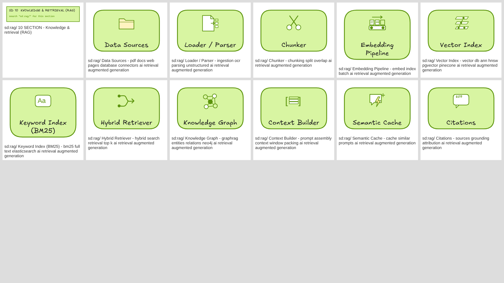

- **Data Sources** - pdf docs web pages database connectors ai retrieval augmented generation
- **Loader / Parser** - ingestion ocr parsing unstructured ai retrieval augmented generation
- **Chunker** - chunking split overlap ai retrieval augmented generation
- **Embedding Pipeline** - embed index batch ai retrieval augmented generation
- **Vector Index** - vector db ann hnsw pgvector pinecone ai retrieval augmented generation
- **Keyword Index (BM25)** - bm25 full text elasticsearch ai retrieval augmented generation
- **Hybrid Retriever** - hybrid search retrieval top k ai retrieval augmented generation
- **Late Interaction (ColBERT)** - colbert maxsim multi vector token level retrieval ai retrieval augmented generation
- **Knowledge Graph** - graphrag entities relations neo4j ai retrieval augmented generation
- **Context Builder** - prompt assembly context window packing ai retrieval augmented generation
- **Semantic Cache** - cache similar prompts ai retrieval augmented generation
- **Citations** - sources grounding attribution ai retrieval augmented generation

## 11 `sd:llmops/` Safety, evals & LLMOps

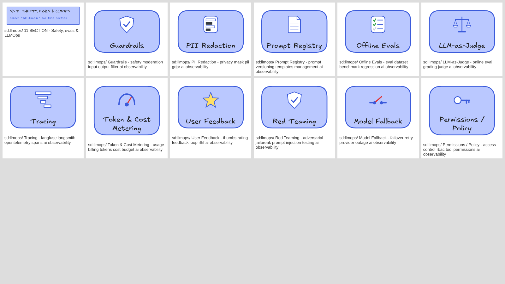

- **Guardrails** - safety moderation input output filter ai observability
- **PII Redaction** - privacy mask pii gdpr ai observability
- **Prompt Registry** - prompt versioning templates management ai observability
- **Offline Evals** - eval dataset benchmark regression ai observability
- **Agent Eval Harness** - task environment verifier harbor terminal bench trajectory sandbox evals ai observability
- **LLM-as-Judge** - online eval grading judge ai observability
- **Tracing** - langfuse langsmith opentelemetry spans ai observability
- **Token & Cost Metering** - usage billing tokens cost budget ai observability
- **User Feedback** - thumbs rating feedback loop rlhf ai observability
- **Red Teaming** - adversarial jailbreak prompt injection testing ai observability
- **Model Fallback** - failover retry provider outage ai observability
- **Permissions / Policy** - access control rbac tool permissions ai observability

## 12 `sd:ops/` Observability, security & ops

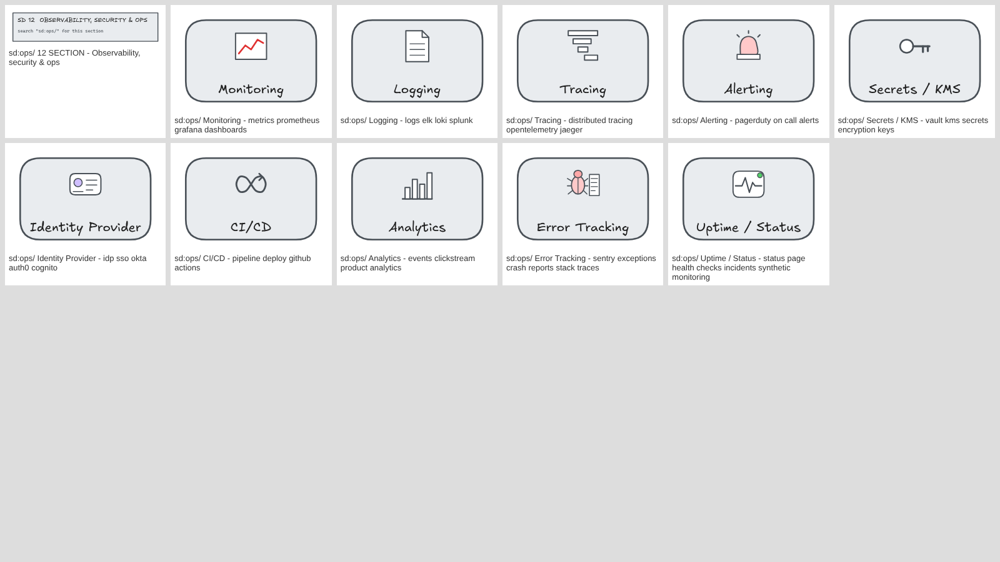

- **Monitoring** - metrics prometheus grafana dashboards
- **Logging** - logs elk loki splunk
- **Tracing** - distributed tracing opentelemetry jaeger
- **Alerting** - pagerduty on call alerts
- **Secrets / KMS** - vault kms secrets encryption keys
- **Identity Provider** - idp sso okta auth0 cognito
- **CI/CD** - pipeline deploy github actions
- **Analytics** - events clickstream product analytics
- **Error Tracking** - sentry exceptions crash reports stack traces
- **Uptime / Status** - status page health checks incidents synthetic monitoring

## 13 `sd:ext/` External systems

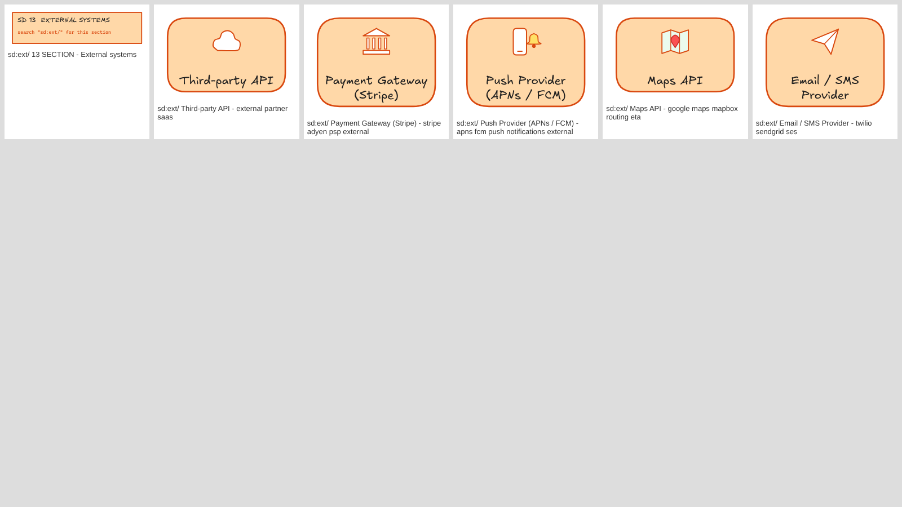

- **Third-party API** - external partner saas
- **AI Answer Engine** - chatgpt search perplexity ai overviews gemini answer engine aeo citations
- **Payment Gateway (Stripe)** - stripe adyen psp external
- **Push Provider (APNs / FCM)** - apns fcm push notifications external
- **Maps API** - google maps mapbox routing eta
- **Email / SMS Provider** - twilio sendgrid ses

## 14 `sd:zone/` Boundaries & zones

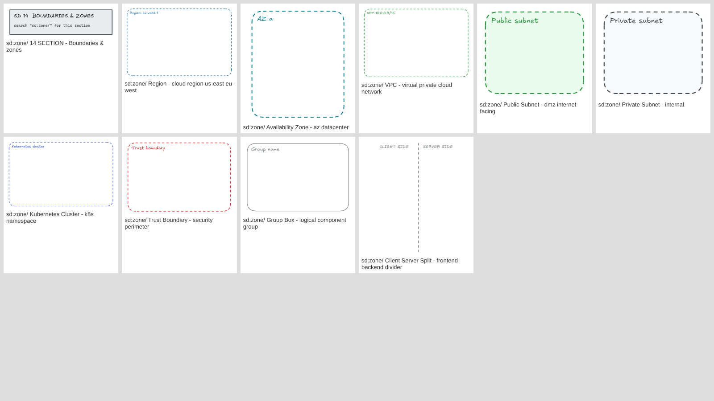

- **Region** - cloud region us-east eu-west
- **Availability Zone** - az datacenter
- **VPC** - virtual private cloud network
- **Public Subnet** - dmz internet facing
- **Private Subnet** - internal
- **Kubernetes Cluster** - k8s namespace
- **Trust Boundary** - security perimeter
- **Group Box** - logical component group
- **Client Server Split** - frontend backend divider

## 15 `sd:link/` Arrows & connectors

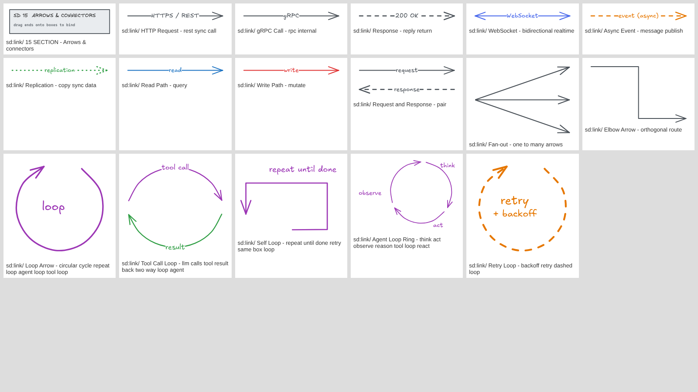

- **HTTP Request** - rest sync call
- **gRPC Call** - rpc internal
- **Response** - reply return
- **WebSocket** - bidirectional realtime
- **Async Event** - message publish
- **Replication** - copy sync data
- **Read Path** - query
- **Write Path** - mutate
- **Request and Response** - pair
- **Fan-out** - one to many arrows
- **Elbow Arrow** - orthogonal route
- **Loop Arrow** - circular cycle repeat loop agent loop tool loop
- **Tool Call Loop** - llm calls tool result back two way loop agent
- **Self Loop** - repeat until done retry same box loop
- **Agent Loop Ring** - think act observe reason tool loop react
- **Retry Loop** - backoff retry dashed loop

## 16 `sd:ui/` UI components

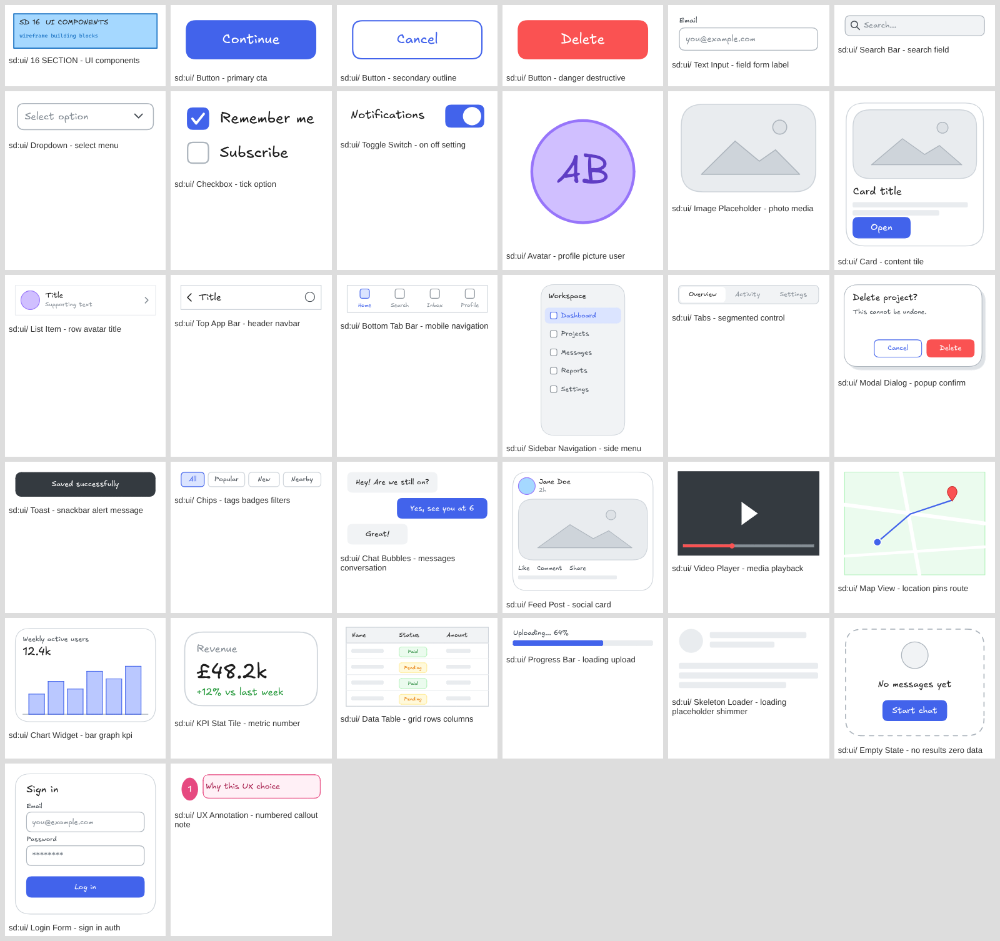

- **Button** - primary cta
- **Button** - secondary outline
- **Button** - danger destructive
- **Text Input** - field form label
- **Search Bar** - search field
- **Dropdown** - select menu
- **Checkbox** - tick option
- **Toggle Switch** - on off setting
- **Avatar** - profile picture user
- **Image Placeholder** - photo media
- **Card** - content tile
- **List Item** - row avatar title
- **Top App Bar** - header navbar
- **Bottom Tab Bar** - mobile navigation
- **Sidebar Navigation** - side menu
- **Tabs** - segmented control
- **Modal Dialog** - popup confirm
- **Toast** - snackbar alert message
- **Chips** - tags badges filters
- **Chat Bubbles** - messages conversation
- **Feed Post** - social card
- **Video Player** - media playback
- **Map View** - location pins route
- **Chart Widget** - bar graph kpi
- **KPI Stat Tile** - metric number
- **Data Table** - grid rows columns
- **Progress Bar** - loading upload
- **Skeleton Loader** - loading placeholder shimmer
- **Empty State** - no results zero data
- **Login Form** - sign in auth
- **UX Annotation** - numbered callout note

## 17 `sd:frame/` Device frames

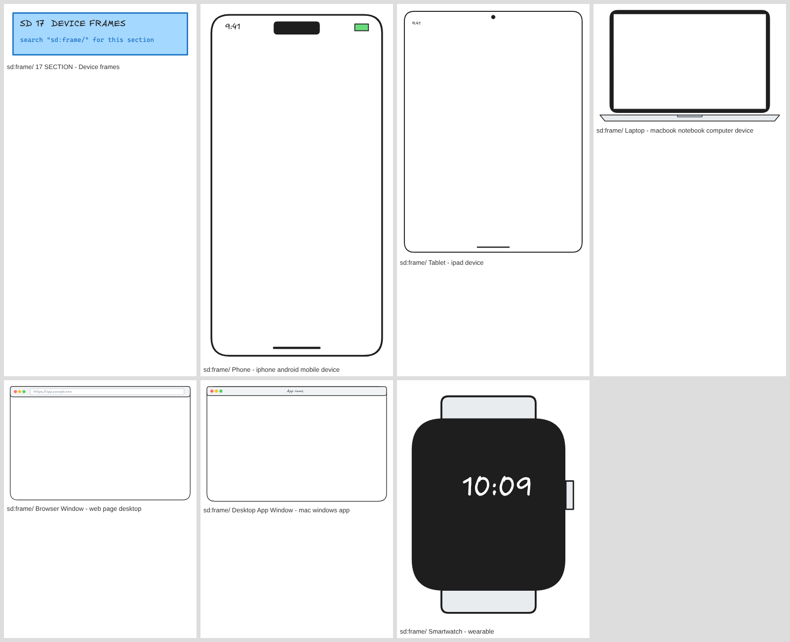

- **Phone** - iphone android mobile device
- **Tablet** - ipad device
- **Laptop** - macbook notebook computer device
- **Browser Window** - web page desktop
- **Desktop App Window** - mac windows app
- **Smartwatch** - wearable

## 18 `sd:screen/` Screen wireframes

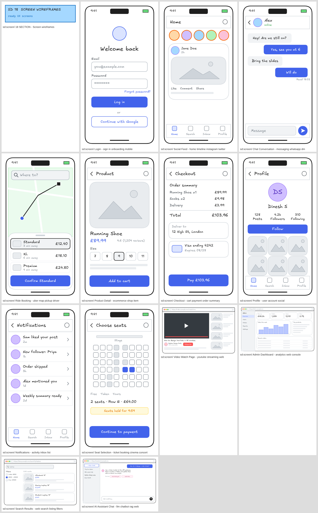

- **Login** - sign in onboarding mobile
- **Social Feed** - home timeline instagram twitter
- **Chat Conversation** - messaging whatsapp dm
- **Ride Booking** - uber map pickup driver
- **Product Detail** - ecommerce shop item
- **Checkout** - cart payment order summary
- **Profile** - user account social
- **Notifications** - activity inbox list
- **Seat Selection** - ticket booking cinema concert
- **Video Watch Page** - youtube streaming web
- **Admin Dashboard** - analytics web console
- **Search Results** - web search listing filters
- **AI Assistant Chat** - llm chatbot rag web

## 19 `sd:pattern/` Architecture patterns

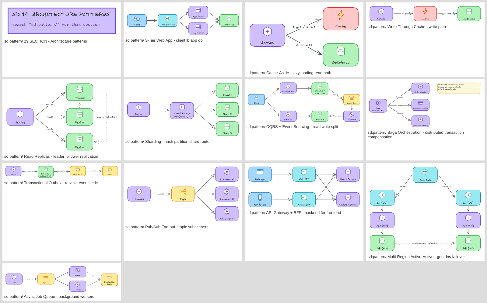

- **3-Tier Web App** - client lb app db
- **Cache-Aside** - lazy loading read path
- **Write-Through Cache** - write path
- **Read Replicas** - leader follower replication
- **Sharding** - hash partition shard router
- **CQRS + Event Sourcing** - read write split
- **Saga Orchestration** - distributed transaction compensation
- **Transactional Outbox** - reliable events cdc
- **Pub/Sub Fan-out** - topic subscribers
- **API Gateway + BFF** - backend for frontend
- **Multi-Region Active-Active** - geo dns failover
- **Async Job Queue** - background workers

## 20 `sd:agentic/` Agentic patterns

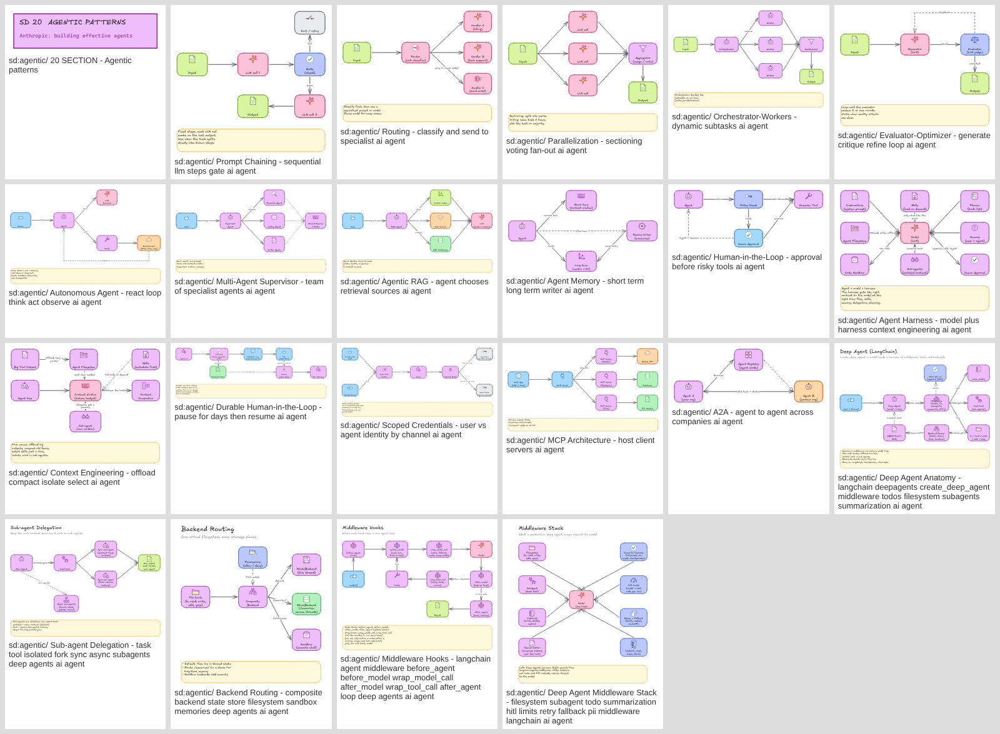

- **Prompt Chaining** - sequential llm steps gate ai agent
- **Routing** - classify and send to specialist ai agent
- **Parallelization** - sectioning voting fan-out ai agent
- **Orchestrator-Workers** - dynamic subtasks ai agent
- **Evaluator-Optimizer** - generate critique refine loop ai agent
- **Autonomous Agent** - react loop think act observe ai agent
- **Multi-Agent Supervisor** - team of specialist agents ai agent
- **Agentic RAG** - agent chooses retrieval sources ai agent
- **Agent Memory** - short term long term writer ai agent
- **Human-in-the-Loop** - approval before risky tools ai agent
- **Agent Harness** - model plus harness context engineering ai agent
- **Context Engineering** - offload compact isolate select ai agent
- **Durable Human-in-the-Loop** - pause for days then resume ai agent
- **Scoped Credentials** - user vs agent identity by channel ai agent
- **MCP Architecture** - host client servers ai agent
- **A2A** - agent to agent across companies ai agent
- **Deep Agent Anatomy** - langchain deepagents create_deep_agent middleware todos filesystem subagents summarization ai agent
- **Sub-agent Delegation** - task tool isolated fork sync async subagents deep agents ai agent
- **Backend Routing** - composite backend state store filesystem sandbox memories deep agents ai agent
- **Middleware Hooks** - langchain agent middleware before_agent before_model wrap_model_call after_model wrap_tool_call after_agent loop deep agents ai agent
- **Deep Agent Middleware Stack** - filesystem subagent todo summarization hitl limits retry fallback pii middleware langchain ai agent

## 21 `sd:tpl/` Full interview designs

- **URL Shortener** - tinyurl bitly
- **Rate Limiter** - throttling api limits
- **Chat System** - whatsapp messenger realtime
- **News Feed** - twitter timeline social
- **Video Streaming** - youtube netflix vod
- **Ride Sharing** - uber lyft dispatch geo
- **Notification System** - push email sms
- **Web Crawler** - search engine spider
- **Payment System** - stripe checkout ledger
- **Search Autocomplete** - typeahead suggestions trie
- **File Storage Sync** - dropbox google drive
- **Ticket Booking** - ticketmaster seats concerts
- **Proximity Service** - yelp nearby places
- **LLM Chat App** - chatgpt assistant genai
- **RAG Pipeline** - retrieval augmented generation
- **AI Agent Platform** - agentic tools mcp
- **Coding Agent** - claude code cursor ai developer
- **Deep Research Agent** - multi agent web research report
- **Customer Support Agent** - ai helpdesk escalation
- **Realtime Voice Agent** - phone call speech ai
- **AI Voice Tutor** - canvas voice learning agent tutor education
- **Workplace Knowledge Agent** - permission aware enterprise search agent work graph
- **Production Agent Platform** - managed deep agents harness infrastructure multi tenant
- **Agent Runtime Platform** - run agents at scale long traces crash resume per tenant isolation sandbox spend caps
- **Enterprise AI Gateway** - llm platform governance
- **AI Visibility Tracker** - aeo geo ai search brand tracking searchable profound
- **Noise-aware Visibility Score** - repeated runs confidence interval share of voice
- **AI Answer Engine** - retrieve rerank generate cite perplexity chatgpt search
- **Prompt Universe** - which questions to track query fan-out clustering
- **Analytics Agent + MCP** - ask why visibility dropped text-to-sql tools
- **AI Crawler Analytics** - gptbot claudebot perplexitybot logs referrals llm analytics
- **Dual-served Content** - markdown for ai crawlers middleware llms txt
- **Site Audit Crawler** - technical seo aeo audit schema robots
- **Search Relevance Eval Loop** - golden set ndcg judgments interleaving
- **Agentic Search Loop** - plan fan-out judge refine code mode
- **Pipeline Migration** - merge two data pipelines dual run reconcile backfill
- **AI Interview Research Platform** - ai moderated interviews qualitative consumer research insights video voice survey
- **Live AI Moderator** - realtime interview agent adaptive probing follow-up questions discussion guide
- **Interview Media Pipeline** - upload transcode transcribe diarize clips highlight reel video processing
- **Insight Synthesis Engine** - qualitative coding themes clustering grounded quotes across interviews analysis
- **Research Knowledge Base** - ask across all past studies cited answers always-on insights consumer intelligence
- **FE News Feed** - facebook twitter linkedin timeline infinite feed composer frontend client architecture
- **FE Autocomplete** - typeahead search box combobox suggestions frontend component
- **FE Chat App** - messenger whatsapp web slack chat client realtime frontend
- **FE Photo Gallery** - pinterest instagram masonry image grid gallery frontend
- **FE E-commerce Storefront** - amazon shopify product listing product detail cart checkout frontend
- **FE Video Player** - netflix youtube video player adaptive bitrate hls dash mse frontend
- **FE Collaborative Editor** - google docs notion collaborative rich text editor crdt presence frontend
- **FE Email Client** - gmail outlook email client inbox offline search frontend
- **FE Spreadsheet Grid** - google sheets excel airtable data grid table virtualization frontend
- **FE Travel Booking** - airbnb booking hotel search map listings date picker frontend
- **FE Mobile Money App** - fintech wallet withdraw payout hybrid ionic capacitor offline low-end android frontend
- **FE Admin Dashboard** - employer hr portal back office data table bulk upload roles frontend

## 22 `sd:fe/` Frontend architecture

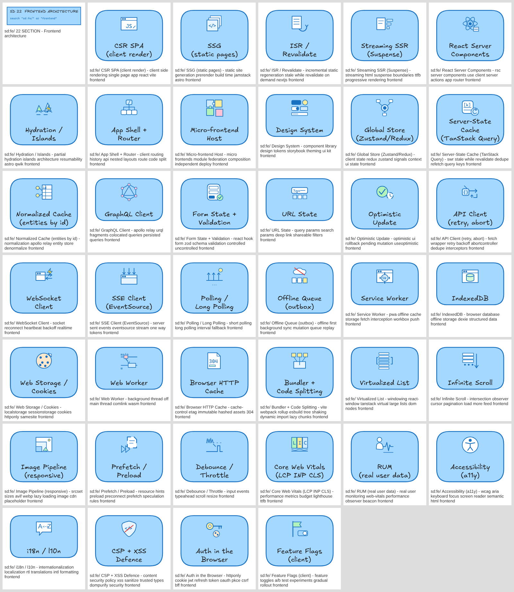

- **CSR SPA (client render)** - client side rendering single page app react vite frontend
- **SSG (static pages)** - static site generation prerender build time jamstack astro frontend
- **ISR / Revalidate** - incremental static regeneration stale while revalidate on demand nextjs frontend
- **Streaming SSR (Suspense)** - streaming html suspense boundaries ttfb progressive rendering frontend
- **React Server Components** - rsc server components use client server actions app router frontend
- **Hydration / Islands** - partial hydration islands architecture resumability astro qwik frontend
- **App Shell + Router** - client routing history api nested layouts route code split frontend
- **Micro-frontend Host** - micro frontends module federation composition independent deploy frontend
- **Design System** - component library design tokens storybook theming ui kit frontend
- **Global Store (Zustand/Redux)** - client state redux zustand signals context ui state frontend
- **Server-State Cache (TanStack Query)** - swr stale while revalidate dedupe refetch query keys frontend
- **Normalized Cache (entities by id)** - normalization apollo relay entity store denormalize frontend
- **GraphQL Client** - apollo relay urql fragments colocated queries persisted queries frontend
- **Form State + Validation** - react hook form zod schema validation controlled uncontrolled frontend
- **URL State** - query params search params deep link shareable filters frontend
- **Optimistic Update** - optimistic ui rollback pending mutation useoptimistic frontend
- **API Client (retry, abort)** - fetch wrapper retry backoff abortcontroller dedupe interceptors frontend
- **WebSocket Client** - socket reconnect heartbeat backoff realtime frontend
- **SSE Client (EventSource)** - server sent events eventsource stream one way tokens frontend
- **Polling / Long Polling** - short polling long polling interval fallback frontend
- **Offline Queue (outbox)** - offline first background sync mutation queue replay frontend
- **Service Worker** - pwa offline cache storage fetch interception workbox push frontend
- **IndexedDB** - browser database offline storage dexie structured data frontend
- **Web Storage / Cookies** - localstorage sessionstorage cookies httponly samesite frontend
- **Web Worker** - background thread off main thread comlink wasm frontend
- **Browser HTTP Cache** - cache-control etag immutable hashed assets 304 frontend
- **Bundler + Code Splitting** - vite webpack rollup esbuild tree shaking dynamic import lazy chunks frontend
- **Virtualized List** - windowing react-window tanstack virtual large lists dom nodes frontend
- **Infinite Scroll** - intersection observer cursor pagination load more feed frontend
- **Image Pipeline (responsive)** - srcset sizes avif webp lazy loading image cdn placeholder frontend
- **Prefetch / Preload** - resource hints preload preconnect prefetch speculation rules frontend
- **Debounce / Throttle** - input events typeahead scroll resize frontend
- **Core Web Vitals (LCP INP CLS)** - performance metrics budget lighthouse ttfb frontend
- **RUM (real user data)** - real user monitoring web-vitals performance observer beacon frontend
- **Accessibility (a11y)** - wcag aria keyboard focus screen reader semantic html frontend
- **i18n / l10n** - internationalization localization rtl translations intl formatting frontend
- **CSP + XSS Defence** - content security policy xss sanitize trusted types dompurify security frontend
- **Auth in the Browser** - httponly cookie jwt refresh token oauth pkce csrf bff frontend
- **Feature Flags (client)** - feature toggles a/b test experiments gradual rollout frontend
- **Signals + Zoneless (Angular)** - angular signals computed effect zoneless change detection onpush frontend
- **Deferrable Views (@defer)** - angular defer lazy blocks incremental hydration triggers placeholder frontend
- **RxJS Streams (NgRx)** - observables switchmap mergemap debouncetime ngrx store effects signalstore frontend
- **Hybrid App Shell (Ionic + Capacitor)** - webview native bridge plugins ionic capacitor low-end android frontend
- **Live Updates (OTA)** - over the air web bundle update channels rollback capgo appflow capawesome frontend
- **Deep Links (App / Universal)** - app links universal links assetlinks aasa routing frontend
- **Push Notifications (FCM / APNs)** - firebase cloud messaging permissions token topics mobile frontend
- **Secure Storage + Biometrics** - keychain keystore face fingerprint step-up auth mobile frontend
- **Money Formatting (minor units, Intl)** - currency integer minor units intl numberformat iso 4217 rounding fintech frontend
- **App Hardening (integrity, pinning)** - play integrity app check root jailbreak detection certificate pinning session timeout masvs frontend

## 23 `sd:fep/` Frontend patterns

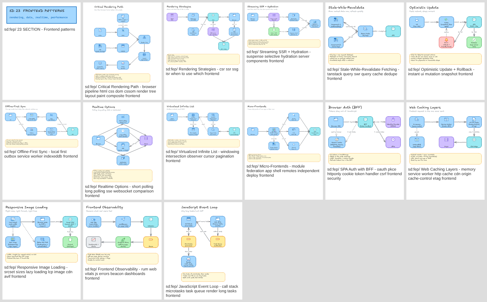

- **Critical Rendering Path** - browser pipeline html css dom cssom render tree layout paint composite frontend
- **Rendering Strategies** - csr ssr ssg isr when to use which frontend
- **Streaming SSR + Hydration** - suspense selective hydration server components frontend
- **Stale-While-Revalidate Fetching** - tanstack query swr query cache dedupe frontend
- **Optimistic Update + Rollback** - instant ui mutation snapshot frontend
- **Offline-First Sync** - local first outbox service worker indexeddb frontend
- **Realtime Options** - short polling long polling sse websocket comparison frontend
- **Virtualized Infinite List** - windowing intersection observer cursor pagination frontend
- **Micro-Frontends** - module federation app shell remotes independent deploy frontend
- **SPA Auth with BFF** - oauth pkce httponly cookie token handler csrf frontend security
- **Web Caching Layers** - memory service worker http cache cdn origin cache-control etag frontend
- **Responsive Image Loading** - srcset sizes lazy loading lcp image cdn avif frontend
- **Frontend Observability** - rum web vitals js errors beacon dashboards frontend
- **JavaScript Event Loop** - call stack microtasks task queue render long tasks frontend
- **Idempotent Payment Submit** - double tap safe retry idempotency key pay button fintech frontend

## 24 emoji

Every Unicode emoji (emojibase-data 18.0.0, Unicode emoji 18) as a 56 px text item, plus every skin-tone version: 1,923 emoji and 2,040 skin tones, 3,963 items. Browse them on the site under Blocks > Emoji, or search the library for `sd:emoji/` and a word.

| Group | Emoji |
|---|---|
| 😀 Smileys & Emotion | 172 |
| 👋 People & Body | 390 |
| 🐻 Animals & Nature | 161 |
| 🍔 Food & Drink | 132 |
| ✈️ Travel & Places | 221 |
| ⚽ Activities | 85 |
| 💡 Objects | 268 |
| ❤️ Symbols | 224 |
| 🏁 Flags | 270 |
